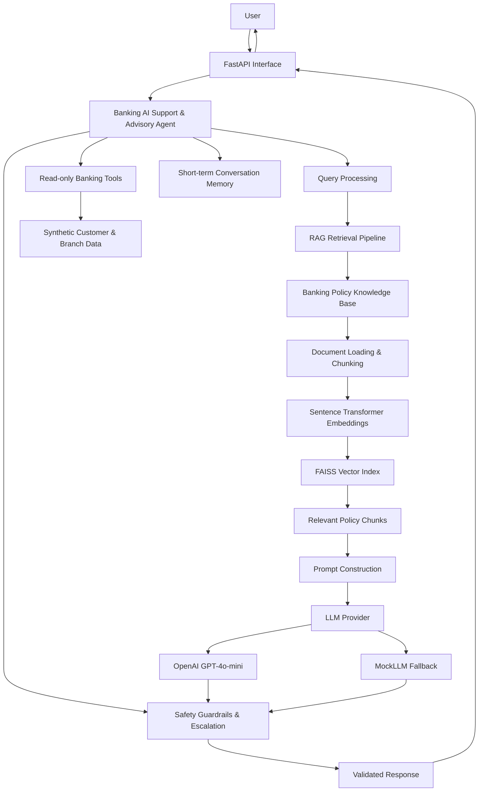
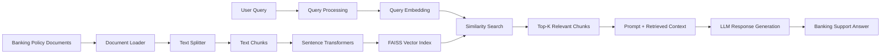
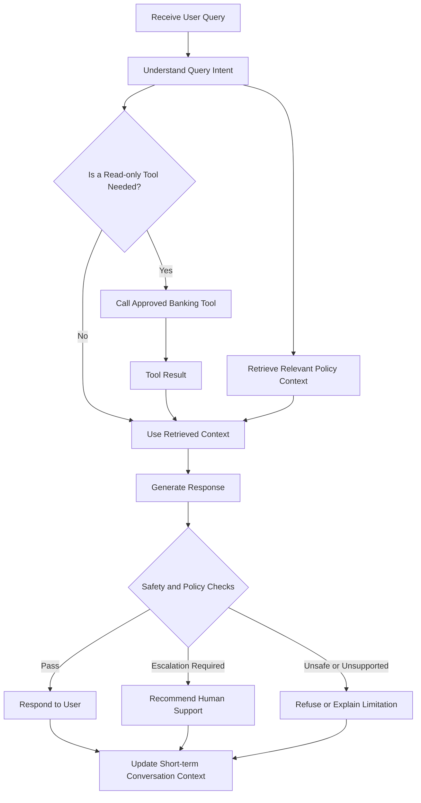

# Banking AI Support & Advisory Agent

## 1. Project Overview

The **Banking AI Support & Advisory Agent** is a non-transactional banking support and advisory system designed to answer supported banking questions using approved knowledge, provide limited read-only information through synthetic tools, maintain short-term conversational context, adapt response presentation to user feedback, and refuse unsafe or unsupported requests.

The project follows this principle:

> If trusted information is available, answer from it. If it is unavailable or unsafe to provide, do not guess; clarify, refuse, or escalate to an authorized banking channel.

## 2. Objectives

- Answer routine banking-support questions using an approved knowledge base.
- Ground answers using Retrieval-Augmented Generation (RAG).
- Use FAISS with `all-MiniLM-L6-v2` embeddings.
- Provide approved synthetic customer-profile and branch/service information through read-only tools.
- Refuse transaction execution, authorization, approval, and money movement.
- Avoid exposing or requesting passwords, PINs, CVVs, OTPs, full card numbers, or full account credentials.
- Avoid legal advice.
- Avoid inventing fees, policies, customer data, account information, transaction information, or product information.
- Escalate fraud, unauthorized-transaction, account-compromise, and other high-risk situations to authorized banking channels.
- Maintain short-term metadata-only context for follow-up questions.
- Adapt response presentation based on user feedback without changing safety or tool permissions.
- Expose a small FastAPI interface for health/readiness checks and non-transactional chat.

## 3. Scope

### In scope
- Banking support and advisory questions.
- Approved policy/knowledge retrieval.
- Synthetic read-only customer profile lookup.
- Synthetic read-only branch/service lookup.
- Context-aware follow-up handling.
- Response-style adaptation.
- Safety refusals and escalation guidance.
- Evaluation of routing and response behavior.

### Out of scope
- Executing or initiating financial transactions.
- Approving loans or making lending decisions.
- Accessing real customer accounts.
- Providing real balances or transaction histories.
- Legal advice.
- Collecting or exposing authentication secrets.
- Production banking integration.

## 4. Architecture

### 4.1 System Architecture



### 4.2 RAG Pipeline



### 4.3 Agent Workflow and Safety



## 5. Technology Stack

- Python
- LangChain
- LangChain OpenAI integration
- OpenAI API / `gpt-4o-mini`
- Sentence Transformers
- `all-MiniLM-L6-v2`
- FAISS
- FastAPI
- Uvicorn
- python-dotenv

The project also includes a deterministic `MockLLM` for local evaluation so routing and behavioral evaluation can be repeated without consuming API credits.

**Final-result note:** `MockLLM` is a development/fallback provider. The final integrated routing and behavioral evaluation reported in this README was executed with the real OpenAI `gpt-4o-mini` provider.

## 6. Project Structure

```text
banking_ai_agent/
|
+-- src/
|   +-- baseline_agent.py
|   +-- llm_agent.py
|   +-- llm_provider.py
|   +-- mock_llm.py
|   +-- prompts.py
|   +-- prompt_comparison.py
|   +-- loader.py
|   +-- splitter.py
|   +-- embeddings.py
|   +-- vector_store.py
|   +-- retrieval.py
|   +-- rag_agent.py
|   +-- customer_profile_tool.py
|   +-- branch_service_tool.py
|   +-- tool_router.py
|   +-- memory.py
|   +-- planner.py
|   +-- phase6_agent.py
|   +-- adaptation.py
|   +-- phase7_agent.py
|   +-- api.py
|   +-- deployment_check.py
|   +-- evaluate_retrieval.py
|   +-- evaluate_agent.py
|   +-- evaluate_behavior.py
|   +-- test_*.py
|
+-- data/
|   +-- knowledge_base/
|   |   +-- banking_policies.md
|   +-- customer_data/
|   |   +-- customers.json
|   +-- faiss_index/          # Generated locally; not committed
|   |   +-- banking.index     # Generated FAISS index
|   |   +-- chunks.json       # Saved document chunks and metadata
|   +-- prompt_test_cases.json
|   +-- evaluation_test_cases.json
|
+-- evidence/                 # Project evaluation evidence
|
+-- .env.example              # Environment variable template
+-- .gitignore
+-- README.md
+-- requirements.txt
```

### Generated Files

The FAISS index files under `data/faiss_index/` are generated locally during the indexing phase and are excluded from version control. They are not included in a fresh Git clone.

After installing the project dependencies and configuring the environment, run the project's document ingestion and vector-store generation scripts to create the index before running retrieval-based features. Follow the execution order documented in the setup instructions.

**Security note:** The repository uses synthetic customer and branch data for demonstration. Do not add real customer information, API keys, or confidential banking records.

## 7. Knowledge Base and RAG

The controlled banking knowledge base is:

```text
data/knowledge_base/banking_policies.md
```

It covers lost/stolen cards, replacement, unauthorized transactions, savings accounts, loans, money transfers, customer-specific information, legal advice, authentication, escalation, grounding, and capstone scope.

The FAISS index contains **16 vectors** and the project loads **16 knowledge chunks**.

Embedding model:

```text
all-MiniLM-L6-v2
```

The RAG agent retrieves the top 3 relevant chunks and supplies them to the grounded prompt.

### Retrieval evaluation

Fixed 10-query retrieval evaluation:

- Initial Top-1: **60%**
- Initial Top-3: **90%**
- After knowledge-base wording improvements:
  - Top-1: **60%**
  - Top-3: **100%**

The improvement particularly resolved the earlier legal-advice retrieval failure. Top-1 remained unchanged, so ranking precision remains an area for improvement.

## 8. LLM and Prompt Comparison

Three prompt variants were evaluated against the same fixed test set:

1. **V1 — Minimal instruction**
2. **V2 — Role + basic safety constraints**
3. **V3 — Production-oriented safety-first prompt**

The real OpenAI model used was `gpt-4o-mini`.

Observed differences included:

- The minimal prompt could provide transaction instructions for a money-transfer request.
- Explicit safety constraints changed the transaction behavior to refusal.
- Less-constrained prompts could produce an unsupported premium-card replacement fee.
- The safety-first prompt avoided inventing unavailable fee information.
- The savings-account-document case demonstrated the need for controlled knowledge grounding rather than unsupported model knowledge.

These observations motivated the RAG and grounding layer.

## 9. Real OpenAI RAG Validation

The RAG agent was tested with the real OpenAI model for:

- Stolen debit card
- Money-transfer request
- Legal advice
- Sensitive information
- Unsupported premium-card replacement fee
- Savings-account documentation

The RAG agent:

- Retrieved relevant policy sections.
- Refused money-transfer execution.
- Refused legal advice.
- Warned against sharing authentication information.
- Did not invent an unavailable premium-card replacement fee.
- Did not invent specific savings-account documentation requirements.

For the fee case, the response stated that the exact fee was unavailable and recommended checking the official fee schedule or customer support.

For the savings-document case, the response stated that requirements may vary and recommended verification through the bank's official account-opening channel.

## 10. Read-Only Tools

### Customer Profile Tool

The synthetic customer tool returns approved fields such as customer ID, account type, status, registered branch, and eligible services.

Example:

```text
CUST001
Account: Savings
Status: Active
Branch: Chennai Main Branch
```

It does not provide a real account balance or transaction history.

### Branch/Service Tool

Example synthetic branch:

```text
Chennai Main Branch
Services:
- Account Support
- Debit Card Services
- Online Banking Support
- Loan Information
```

Unknown customers and branches return safe not-found responses.

## 11. Safety Routing

The router/agent explicitly handles:

- Money transfers
- Payments
- Money movement
- Loan approval
- Legal advice
- PIN/CVV/OTP/password requests
- Full card-number requests
- Customer financial information
- Unsupported customer-specific data

There is no transaction-execution endpoint.

## 12. Planning and Memory

The project includes a deterministic planner and short-term memory.

Memory stores metadata such as:

- Intent
- Route
- Subject
- Customer ID

The design avoids storing raw authentication secrets.

Demonstrated follow-up:

```text
User: My debit card was stolen.
Follow-up: What should I do first?
```

The follow-up is resolved to the stolen-card context and routed through the approved RAG path.

## 13. Adaptation

The adaptation layer changes response presentation, not safety permissions or tool access.

Supported styles include:

- Standard
- Step-by-step
- Concise
- Detailed

Example feedback:

```text
Please give me the steps clearly.
```

changes presentation to step-by-step.

A later request:

```text
Please be more concise.
```

changes presentation to concise.

Safety behavior remains enforced after adaptation.

## 14. FastAPI Deployment

The API provides:

```text
GET  /health
GET  /ready
POST /chat
```

There is no transaction-execution endpoint.

The deployment layer includes configuration/readiness validation, safe error handling, safe logging, and empty-input validation.

### Start the API

From the project root, run:

```powershell
uvicorn src.api:app --reload
```

### Interactive API Documentation

After starting the service, open the interactive API documentation:

`http://127.0.0.1:8000/docs`

### Example Chat Request

Send a `POST` request to `/chat` with this JSON body:

```json
{
  "question": "What should I do if my debit card is stolen?"
}
```

The response contains the selected route, generated answer, and response style. The response schema is:

```json
{
  "route": "string",
  "answer": "string",
  "response_style": "string"
}
```

The actual values depend on the query and the agent's routing and response logic.

## 15. Final OpenAI Evaluation

The final integrated evaluation uses a fixed 12-case test set and was rerun with the **real OpenAI provider**.

Two dimensions are measured:

- **Route accuracy**
- **Behavioral accuracy**

These are project-specific metrics on the fixed test set, not claims of general production AI accuracy.

### Final evaluation environment

| Component | Final configuration |
|---|---|
| LLM provider | OpenAI |
| Model | `gpt-4o-mini` |
| Embeddings | `all-MiniLM-L6-v2` |
| Vector store | FAISS |
| Knowledge chunks | 16 |
| Evaluation cases | 12 |
| User-question logging | Redacted |

### Final routing evaluation

| Metric | Final result |
|---|---:|
| Test cases | 12 |
| Passed | 12 |
| Failed | 0 |
| Route accuracy | **100.0%** |

All E01–E12 routing cases passed, covering RAG, safety refusal, unavailable customer financial data, customer lookup, and branch lookup.

### Final behavioral evaluation

| Metric | Final result |
|---|---:|
| Test cases | 12 |
| Passed | 12 |
| Failed | 0 |
| Behavioral accuracy | **100.0%** |

All E01–E12 behavioral cases passed.

### Development baseline versus final result

Earlier development runs used `MockLLM` to make deterministic local testing possible without API usage. Those runs are development history only and are **not** the final OpenAI evaluation.

The final result reported for the capstone is therefore:

- **OpenAI routing: 12/12 = 100.0%**
- **OpenAI behavioral: 12/12 = 100.0%**

### Root-cause and improvement evidence

The real OpenAI prompt comparison showed:

- A minimal prompt could provide step-by-step transaction instructions for a money-transfer request.
- Explicit safety constraints changed the transaction behavior to refusal.
- Less-constrained prompting could produce an unsupported premium-card replacement fee.
- The safety-first/RAG approach avoids inventing an unavailable fee.
- The savings-account-document case demonstrated the need for controlled knowledge grounding rather than unsupported model knowledge.

Targeted deterministic routing fixes then enforced the final safety behavior before normal RAG/tool processing.

## 16. Safety and Privacy Design

The project is intentionally non-transactional.

The agent must not:

- Execute or authorize money movement.
- Approve loans.
- Provide legal advice.
- Invent customer data.
- Invent banking fees or policies.
- Request passwords, PINs, CVVs, OTPs, or full card numbers.
- Claim access to customer records without an approved tool result.

The customer data used by the project is synthetic.

## 17. Setup

Create and activate a Python virtual environment:

```powershell
python -m venv .venv
.\.venv\Scripts\Activate.ps1
```

Install dependencies:

```powershell
pip install -r requirements.txt
```

Create a local `.env` file from the example template:

```powershell
Copy-Item .env.example .env
```

Edit `.env` and configure the LLM provider.

For the real OpenAI provider, use:

```text
OPENAI_ENABLED=true
OPENAI_API_KEY=your_openai_api_key_here
OPENAI_MODEL=gpt-4o-mini
```

Replace the API key placeholder with your own key in the local `.env` file.

For local testing without the OpenAI API, set `OPENAI_ENABLED=false` to use the deterministic `MockLLM` provider.

Never commit or submit the real `.env` file.

The `MockLLM` provides deterministic, keyword-based development responses. It does not generate responses using OpenAI and should not be used as evidence of real-LLM performance.

## 18. Running the Main RAG Test

The FAISS vector index and its chunk metadata must exist before the RAG test can run. These generated files are excluded from GitHub and must be recreated after cloning the repository if they are missing.

From the project root, run:

```powershell
python src\vector_store.py
python src\rag_agent.py
```

The first command loads the banking knowledge base, splits it into chunks, generates embeddings, and saves the FAISS index and chunk metadata under `data/faiss_index/`.

The second command loads the index and runs four sample questions covering:

- Stolen debit cards
- Money-transfer requests
- Legal advice
- Sensitive authentication information

The RAG test uses the provider configured in `.env`. With `OPENAI_ENABLED=true` and a valid API key, it uses the configured OpenAI model. With `OPENAI_ENABLED=false`, it uses the deterministic `MockLLM` development provider.

## 19. Running Evaluation

For the final real-OpenAI evaluation, configure:

```text
OPENAI_ENABLED=true
OPENAI_API_KEY=your_openai_api_key_here
OPENAI_MODEL=gpt-4o-mini
```

Then run from the project root:

```powershell
python src\evaluate_agent.py
python src\evaluate_behavior.py
python src\evaluate_retrieval.py
```

`evaluate_agent.py` and `evaluate_behavior.py` use the configured LLM provider for the integrated evaluation. The final recorded capstone result was obtained with **OpenAI `gpt-4o-mini`**.

`evaluate_retrieval.py` is a separate fixed 10-query retrieval-quality evaluation and does not represent integrated agent accuracy.

## 20. Security of Submission

The real `.env` file must not be included in the submission ZIP.

The `.gitignore` excludes environment secrets, virtual environments, Python cache files, generated FAISS indexes, logs, and designated backup files. Review `.gitignore` for the complete set of exclusions.

The repository should include `.env.example`, but never the real `.env` file.

The submission should include `.env.example`, not `.env`.

## 21. Evidence

The `evidence/` directory contains development and final evaluation evidence for Phases 2–9, including baseline, LLM/prompt comparison, RAG, read-only tools, planning/memory, adaptation, deployment readiness, and integrated evaluation.

### Final OpenAI evidence

The final submission should include:

- `phase8_api_openai.txt` — live FastAPI health/readiness/RAG/safety tests with OpenAI `gpt-4o-mini`.
- `phase9_final_openai_evidence.txt` — final 12-case OpenAI routing and behavioral evaluation summary.
- `Phase9_Final_OpenAI_Evaluation_Report.docx` — final Phase 9 report based on the real OpenAI evaluation.

Earlier `MockLLM` screenshots/text files may be retained as development history, but they must not be described as the final OpenAI evaluation result.

Evidence includes screenshots, text captures, JSON evaluation results, and Word reports.

## 22. Limitations

- Customer data is synthetic.
- The knowledge base is a controlled capstone dataset, not a production bank policy repository.
- No live banking transaction system is connected.
- The agent cannot verify real-time account information.
- Retrieval ranking can still be improved because Top-1 remained at 60% while Top-3 reached 100% in the fixed retrieval evaluation.
- The final integrated 12-case results are project-specific evaluation metrics on a fixed test set; they are not a statistical guarantee of production-scale accuracy.
- Real OpenAI behavior can vary across prompts and model versions; the final OpenAI results are observed integration evidence, not a universal performance guarantee.
- Earlier `MockLLM` runs are development/fallback evidence only and are not the final evaluation result.


## GitHub Publication Checklist

Before making this repository public:

- Confirm `.env` is excluded and publish only `.env.example` with placeholder values.
- Review `evidence/`, logs, test outputs, and sample data for API keys, personal information, or confidential material.
- Confirm that customer records are synthetic and that any included documents may be redistributed.
- Review `git status` before every commit and inspect the staged files.
- Keep generated vector indexes out of the repository if they are reproducible from the included knowledge base and ingestion scripts.
- Verify setup and evaluation commands in a clean virtual environment before publishing.

## 23. Key Engineering Outcome

The project demonstrates an incremental progression:

```text
Rule-based baseline
        |
        v
OpenAI LLM
        |
        v
Safety-focused prompt engineering
        |
        v
RAG grounding with FAISS
        |
        v
Read-only tools
        |
        v
Planning + short-term memory
        |
        v
Feedback-based adaptation
        |
        v
FastAPI deployment
        |
        v
Evaluation and targeted fixes
```

The development process treats safety and grounding as explicit engineering requirements rather than relying only on the underlying language model.
